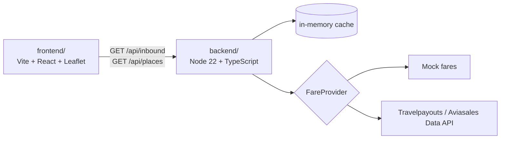

# Whence

Pick where you want to go, and see every airport you could fly *from*, priced on a map.
Whence inverts the usual flight search: one destination, all origins.

**Live demo:** https://toldry.github.io/Whence/ (sample prices from the built-in mock, not real fares).



## Layout

| Path | What it is |
|------|------------|
| [`backend/`](backend/) | Inbound fare search API. Mock provider by default, Travelpayouts with a token. |
| [`frontend/`](frontend/) | Search panel, filters, results list and map. Runs on a built-in mock or against the back end. |
| [`docs/inbound-api.md`](docs/inbound-api.md) | The API contract (v0.2) shared by both. |

## Quick start

Back end (http://localhost:8787, mock data unless `TRAVELPAYOUTS_API_TOKEN` is set in `backend/.env`):

```sh
cd backend
npm install
npm start
```

Front end against that back end (http://localhost:5173):

```sh
cd frontend
npm install
VITE_API_BASE=http://localhost:8787 npm run dev
```

PowerShell:

```powershell
cd frontend; npm install; $env:VITE_API_BASE="http://localhost:8787"; npm run dev
```

Leave `VITE_API_BASE` unset to use the in-browser mock instead. Each package has its own
`npm test` and `npm run typecheck`; see the package READMEs for details and known gaps.

Secrets live only in `backend/.env`, which is git-ignored. Copy `backend/.env.example` to start.

## Deployment

`.github/workflows/pages.yml` builds `frontend/` and publishes it to GitHub Pages on every push to `main`
that touches the front end (or on a manual run). It uses the in-browser mock unless a repository
variable named `VITE_API_BASE` is set (Settings > Secrets and variables > Actions > Variables), in which
case the built site calls that back end instead. The back end itself is not deployed by this workflow.
