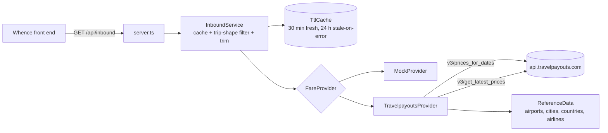

# Whence back end

The API behind Whence: "every origin airport with a cached fare to one destination".
It serves the contract in [`docs/inbound-api.md`](../docs/inbound-api.md).

- **Stack:** Node.js 22.18+ running TypeScript directly (built-in type stripping).
  No runtime dependencies, no build step. `typescript` is a dev dependency for type checks only.
- **Data source:** Travelpayouts / Aviasales Data API, behind a swappable `FareProvider`
  interface. A mock provider (same fares as the design prototype) runs with no token.
- **Sized for personal use:** one process, in-memory cache, no database.



## Run it

```sh
npm install
npm start
```

That starts on http://localhost:8787 with the mock provider. To use real data, copy
`.env.example` to `.env`, set `TRAVELPAYOUTS_API_TOKEN` (and optionally `TRAVELPAYOUTS_MARKER`), then:

```sh
node --env-file=.env src/server.ts
```

Tests and type check:

```sh
npm test
```

```sh
npm run typecheck
```

## Endpoints

| Route | What it does |
|---|---|
| `GET /api/inbound?destination=LIS&trip=round&date_mode=flex&month=2027-03&flex_kind=weekend` | Fares from every origin, per the contract |
| `GET /api/places?q=lis` | Destination autocomplete: `[{ iata, name, city, country, country_code, lat, lon, type }]` |
| `GET /api/health` | `{ ok, provider }` |

Errors are `{ "error": { "code", "message" } }`: `invalid_params` (400),
`upstream_unavailable` (502), `internal_error` (500).

## How a search works

1. Parameters are validated (`src/query.ts`).
2. The cache is checked by a canonical key. Concurrent identical searches share one upstream load.
   If the upstream fails after the TTL, the last good answer is served for up to `CACHE_STALE_HOURS`
   with `meta.stale: true`.
3. The Travelpayouts provider calls two endpoints with only `destination` set, in parallel:
   - `prices_for_dates` gives airline, duration and a booking link, but no `found_at`.
   - `get_latest_prices` gives `found_at`, but no airline or link.
   Rows are merged on (origin city, depart date, return date). Cities only the second endpoint knows
   about are added as city-level origins (e.g. `LON`, plotted at the city centre, `airlines: []`).
4. The service drops fares that don't fit the trip shape or can't be plotted, then keeps per origin
   the cheapest fare plus the cheapest nonstop.

Flexible trip shapes (cached prices are sparse, so each accepts a small window):

| `flex_kind` | Depart | Stay |
|---|---|---|
| `weekend` | Thu, Fri or Sat | 1 to 4 days, back on Sun or Mon |
| `week` | any day | 6 to 8 days |
| `custom` | any day | `length` ± 1 day |

## Configuration

See `.env.example`. The main knobs:

| Variable | Default | Notes |
|---|---|---|
| `FARE_PROVIDER` | `travelpayouts` if a token is set, else `mock` | |
| `TRAVELPAYOUTS_API_TOKEN` | | From the Travelpayouts dashboard |
| `TRAVELPAYOUTS_MARKER` | | Affiliate marker, appended to booking links |
| `TRAVELPAYOUTS_MARKETS` | `auto` | `auto` = destination's country (LIS → `pt`); or a list like `pt,gb,de` |
| `TRAVELPAYOUTS_MAX_PAGES` | `2` | Pages of 1000 rows per endpoint per market |
| `CACHE_TTL_MINUTES` | `30` | |
| `CORS_ORIGIN` | `*` | Set to the front end's origin when deployed |

Each uncached search costs `2 × markets × pages` upstream calls at most (4 with the defaults).

## Swapping the data source

Implement `FareProvider` from `src/types.ts` (`searchInbound`, `searchPlaces`) and return it from
`createProvider` in `src/config.ts`. The service handles caching, filtering and trimming, so a
provider only has to return raw fares plus airport metadata for each origin.

## Known gaps

- **Not yet run against the live API.** This was built in a sandbox that cannot reach
  api.travelpayouts.com. The request and response shapes follow the published docs
  (https://support.travelpayouts.com/hc/en-us/articles/203956163) and are covered by tests with
  recorded-style fixtures, but the first real run may need small fixes. Things to check then:
  whether `get_latest_prices` honours `limit`, the time zone of `found_at` (assumed UTC), and which
  `market` gives the best coverage.
- Flexible round trips ask the upstream for a return in the same month, so a trip that starts on
  the last weekend and returns in the next month is missed.
- Reference data (about 10 MB) is cached to `.cache/reference/` for 7 days.
