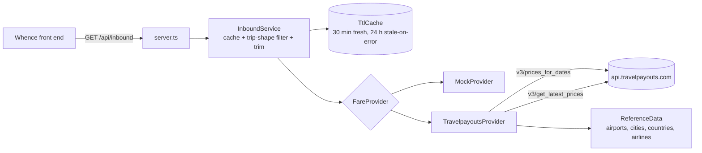

# Whence back end

The API behind Whence: "every origin airport with a cached fare to one destination".
It serves the contract in [`docs/inbound-api.md`](../docs/inbound-api.md).

- **Stack:** Node.js 22.18+ running TypeScript directly (built-in type stripping).
  No runtime dependencies, no build step. `typescript` is a dev dependency for type checks only.
- **Data source:** Travelpayouts / Aviasales Data API, behind a swappable `FareProvider`
  interface. A mock provider (same fares as the design prototype) runs with no token.
- **Sized for personal use:** one process, in-memory cache, no database.



## Run it

```sh
npm install
npm start
```

That starts on http://localhost:8787 with the mock provider. To use real data, copy
`.env.example` to `.env`, set `TRAVELPAYOUTS_API_TOKEN` (and optionally `TRAVELPAYOUTS_MARKER`), then:

```sh
node --env-file=.env src/server.ts
```

Tests and type check:

```sh
npm test
```

```sh
npm run typecheck
```

## Endpoints

| Route | What it does |
|---|---|
| `GET /api/inbound?destination=LIS&trip=round&date_mode=flex&month=2027-03&flex_kind=weekend` | Fares from every origin, per the contract |
| `GET /api/places?q=lis` | Destination autocomplete: `[{ iata, name, city, country, country_code, lat, lon, type }]` |
| `GET /api/health` | `{ ok, provider }` |

Errors are `{ "error": { "code", "message" } }`: `invalid_params` (400),
`upstream_unavailable` (502), `internal_error` (500).

## How a search works

1. Parameters are validated (`src/query.ts`).
2. The cache is checked by a canonical key. Concurrent identical searches share one upstream load.
   If the upstream fails after the TTL, the last good answer is served for up to `CACHE_STALE_HOURS`
   with `meta.stale: true`.
3. The Travelpayouts provider calls two endpoints with only `destination` set, in parallel:
   - `prices_for_dates` gives airline, duration and a booking link, but no `found_at`
     (when no sighting matches, `found_at` is the start of the link's `search_date` day, UTC).
   - `get_latest_prices` gives `found_at`, but no airline or link.

   Each is called twice: grouped per day (`unique=false` / `group_by=dates`) and per origin
   (`unique=true` / `group_by=directions`). Without an origin, the per-day grouping returns only
   the cheapest fares of each day across all origins, so a one-way month shows about 10 origins;
   the per-origin grouping returns every origin's cheapest fare of the month (see "Live API notes").
   Rows are merged on (origin city, depart date, return date). Cities only the second endpoint knows
   about are added as city-level origins (e.g. `LON`, plotted at the city centre, `airlines: []`).
   Flexible round trips leave the return month open, so trips that return next month are found.
4. The service drops fares that don't fit the trip shape or can't be plotted, then keeps per origin
   the cheapest fare plus the cheapest nonstop.

Flexible trip shapes (cached prices are sparse, so each accepts a small window):

| `flex_kind` | Depart | Stay |
|---|---|---|
| `weekend` | Thu, Fri or Sat | 1 to 4 days, back on Sun or Mon |
| `week` | any day | 6 to 8 days |
| `custom` | any day | `length` ± 1 day |

## Configuration

See `.env.example`. The main knobs:

| Variable | Default | Notes |
|---|---|---|
| `FARE_PROVIDER` | `travelpayouts` if a token is set, else `mock` | |
| `TRAVELPAYOUTS_API_TOKEN` | | From the Travelpayouts dashboard |
| `TRAVELPAYOUTS_MARKER` | | Affiliate marker, appended to booking links |
| `TRAVELPAYOUTS_MARKETS` | `auto` | `auto` = destination's country (LIS → `pt`); or a list like `pt,gb,de`. Measured live, the market made no difference (see below), so keep one |
| `TRAVELPAYOUTS_MAX_PAGES` | `2` | Pages of 1000 rows per endpoint per market |
| `CACHE_TTL_MINUTES` | `30` | |
| `CORS_ORIGIN` | `*` | Set to the front end's origin when deployed |

Each uncached search costs `4 × markets × pages` upstream calls at most. In practice it is 4: no
response came near 1000 rows (London round trips for a month: 876), so the second page is never read.

## Swapping the data source

Implement `FareProvider` from `src/types.ts` (`searchInbound`, `searchPlaces`) and return it from
`createProvider` in `src/config.ts`. The service handles caching, filtering and trimming, so a
provider only has to return raw fares plus airport metadata for each origin.

## Live API notes (measured 10 Nov 2026)

Checked against api.travelpayouts.com for LIS, KEF and INV (Inverness), Dec 2026, Feb 2027 and
May 2027, one-way and round trip, markets `pt`/`is`, `gb`, `de`, `us`:

- **Market:** every market returned the same rows (±1 origin). It is not worth calling more than one.
- **`found_at`** is UTC with a `Z`. Prices are at most about 7 days old; the median is 2 to 4 days.
- **`get_latest_prices`** honours `limit`, `page` and `period_type=month`. Its `depart_date` and
  `return_date` are full timestamps (`2027-03-07T07:15:00+01:00`), not dates as documented; the
  provider keeps the date part.
- **`prices_for_dates` links** carry `search_date=DDMMYYYY`, which matched the UTC date of
  `found_at` for all 611 fares that appear in both endpoints.
- **Paging:** the largest response seen was 900 rows (IST, round trip, one month), below the
  1000-row page, so paging has not been exercised live.
- **Coverage** (origins after the trip-shape filter, from the running back end):

| Search | LIS | KEF | INV |
|---|---|---|---|
| Dec 2026, one-way | 231 | 118 | 5 |
| Dec 2026, round, weekend | 38 | 17 | 2 |
| Dec 2026, round, week | 73 | 43 | 0 |
| Feb 2027, one-way | 122 | 39 | 1 |
| Feb 2027, round, weekend | 16 | 7 | 1 |
| May 2027, round, week | 29 | 26 | 0 |

  Before the per-origin calls, LIS one-way in Feb 2027 showed 11 origins and every `found_at` was null.

## Known gaps

- Round-trip weekend searches stay sparse: the per-origin call gives each origin's single cheapest
  trip of the month, which is often not a weekend. Asking per departure day (about 13 extra calls
  for a weekend month) would find more.
- Small airports have little cached data (INV: 0 to 5 origins a month); nothing on our side fixes that.
- Reference data (about 10 MB) is cached to `.cache/reference/` for 7 days.
